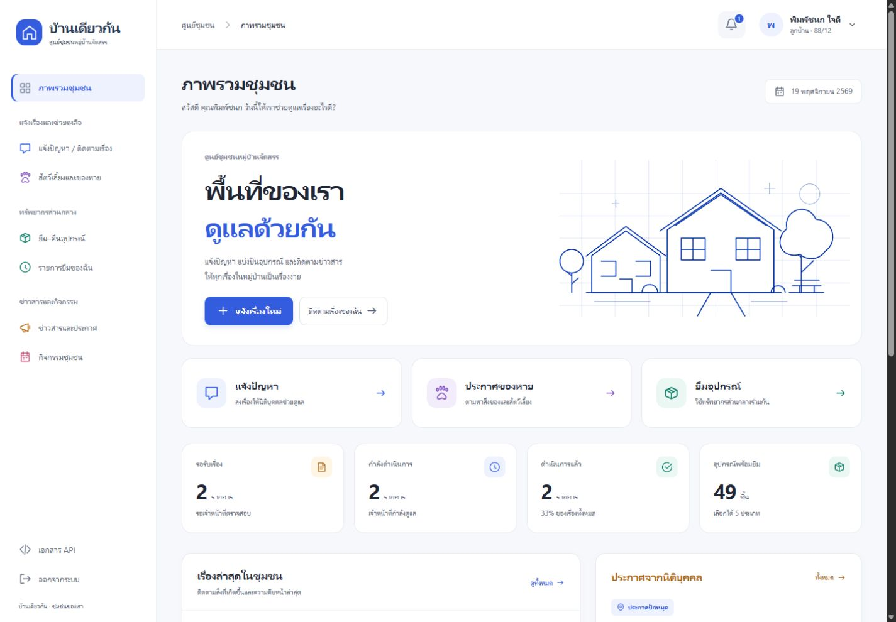

# บ้านเดียวกัน — Village Community Portal

ระบบศูนย์ชุมชนหมู่บ้านจัดสรรสำหรับ **ลูกบ้าน / นิติบุคคล / ผู้ดูแลระบบ** ใช้ **Docker + MySQL 8.4** พร้อมเว็บภาษาไทยที่รองรับมือถือ, **55 REST API endpoints** และฐานข้อมูล **13 ตาราง**



หน้าเว็บแบ่งเมนูเป็น **แจ้งเรื่องและช่วยเหลือ / ทรัพยากรส่วนกลาง / ข่าวสารและกิจกรรม** พร้อมสีและไอคอนประจำฟีเจอร์: แจ้งเรื่องสีน้ำเงิน, ของหายสีม่วง, อุปกรณ์สีเขียว, ประกาศสีอำพัน และกิจกรรมสีชมพู รองรับหน้าจอคอมพิวเตอร์ แท็บเล็ต และมือถือ

## สารบัญ

- [สิ่งที่ต้องติดตั้ง](#สิ่งที่ต้องติดตั้ง)
- [ติดตั้งและเปิดใช้งานครั้งแรก](#ติดตั้งและเปิดใช้งานครั้งแรก)
- [บัญชีสำหรับทดลองใช้งาน](#บัญชีสำหรับทดลองใช้งาน)
- [วิธีใช้งานเบื้องต้น](#วิธีใช้งานเบื้องต้น)
- [หยุดและเปิดระบบครั้งต่อไป](#หยุดและเปิดระบบครั้งต่อไป)
- [เปิดด้วยคำสั่งเอง](#เปิดด้วยคำสั่งเอง)
- [แก้ปัญหาที่พบบ่อย](#แก้ปัญหาที่พบบ่อย)
- [ทดสอบระบบ](#ทดสอบระบบ)
- [โครงสร้างโปรเจกต์และเอกสาร](#โครงสร้างโปรเจกต์และเอกสาร)

## สิ่งที่ต้องติดตั้ง

| สิ่งที่ต้องมี | รายละเอียด |
|---|---|
| Docker Desktop | ติดตั้งและเปิด engine ให้พร้อม ใช้ Linux containers |
| เว็บเบราว์เซอร์ | เช่น Chrome, Edge หรือ Firefox |
| อินเทอร์เน็ต | ใช้ดาวน์โหลด image และแพ็กเกจในการ build ครั้งแรก |
| Git (ไม่บังคับ) | ใช้ clone / pull; หากไม่มีใช้ Download ZIP ได้ |

**ไม่ต้องติดตั้ง Node.js, MySQL, XAMPP หรือ phpMyAdmin บนเครื่องแยก** เพราะเว็บและ MySQL รันอยู่ใน Docker

สำหรับ Windows ให้ติดตั้งตาม [คู่มือ Docker Desktop อย่างเป็นทางการ](https://docs.docker.com/desktop/setup/install/windows-install/) หาก Docker แจ้งเรื่อง WSL 2 หรือ virtualization ให้ทำตามขั้นตอนของ Docker ก่อนเปิดโปรเจกต์

## ติดตั้งและเปิดใช้งานครั้งแรก

### 1. ดาวน์โหลดโปรเจกต์

**วิธีง่าย: Download ZIP**

1. ที่หน้า repository นี้ กด **Code → Download ZIP**
2. คลิกขวาไฟล์ ZIP → **Extract All / แตกไฟล์ทั้งหมด**
3. เปิดโฟลเดอร์ที่แตกแล้ว ต้องเห็น `docker-compose.yml` และ `START-DOCKER.cmd`

> อย่ารันไฟล์จากในหน้าต่าง ZIP โดยตรง ต้องแตกไฟล์ก่อน หาก repository เป็น Private ต้องเข้าสู่ระบบบัญชีที่มีสิทธิ์จึงจะดาวน์โหลดได้

**หรือใช้ Git**

```sh
git clone https://github.com/67070282/village-community-portal.git
cd village-community-portal
```

### 2. เปิด Docker Desktop

เปิด Docker Desktop และรอให้ engine พร้อม หากเพิ่งติดตั้งและระบบขอ restart ให้ทำให้เสร็จก่อน

ตรวจด้วย Terminal ได้:

```sh
docker --version
docker compose version
docker info
```

คำสั่งสุดท้ายต้องไม่ขึ้น `Cannot connect to the Docker daemon` หรือข้อความว่า engine ยังไม่ทำงาน

### 3. เปิดโปรเจกต์

**Windows: ดับเบิลคลิก `START-DOCKER.cmd`**

หรือเปิด PowerShell ในโฟลเดอร์โปรเจกต์แล้วรัน:

```powershell
.\START-DOCKER.cmd
```

ตัวเปิดจะทำให้โดยอัตโนมัติ:

1. ตรวจว่า Docker engine ทำงาน
2. สร้าง `.env` พร้อมรหัสผ่าน MySQL และ JWT secret แบบสุ่ม หากยังไม่มีไฟล์
3. ดาวน์โหลด image ของ Node.js และ MySQL
4. build และเปิดเว็บกับฐานข้อมูล
5. รอ health check จนระบบพร้อม

ครั้งแรกอาจใช้เวลาหลายนาทีตามความเร็วอินเทอร์เน็ตและเครื่อง ไม่ต้อง import SQL หรือสร้างตารางเอง ระบบจะสร้าง schema, indexes และข้อมูลตัวอย่างเมื่อฐานข้อมูลว่าง

### 4. เปิดเว็บไซต์

| หน้า | ที่อยู่เริ่มต้น |
|---|---|
| เว็บไซต์ | http://127.0.0.1:3000 |
| เอกสาร API ที่ทดลองเรียกได้ | http://127.0.0.1:3000/docs |
| OpenAPI JSON | http://127.0.0.1:3000/api/v1/openapi.json |
| ตรวจสถานะระบบ | http://127.0.0.1:3000/api/v1/health |

health endpoint ต้องแสดง `status: ok` และ `database: mysql`

`START-DEMO.cmd` เป็นชื่อเดิมที่ยังเรียกตัวเปิด Docker เดียวกันได้ ไม่ได้สลับไปใช้ฐานข้อมูลอื่น

## บัญชีสำหรับทดลองใช้งาน

หน้าเข้าสู่ระบบมีปุ่มเลือกบทบาท หรือกรอกข้อมูลต่อไปนี้:

| บทบาท | อีเมล | รหัสผ่านเว็บ |
|---|---|---|
| ลูกบ้าน | resident@village.demo | Village@123 |
| นิติบุคคล | juristic@village.demo | Village@123 |
| Admin | admin@village.demo | Village@123 |

บัญชีและรายการเริ่มต้นเป็นข้อมูลสาธิต รหัสผ่านเว็บด้านบนต่างจากรหัสผ่าน MySQL ที่สร้างไว้ใน `.env` วันที่กิจกรรมตัวอย่างอิงวันที่สร้างฐานข้อมูลครั้งแรก

## วิธีใช้งานเบื้องต้น

| ผู้ใช้ | เริ่มทดลองอย่างไร |
|---|---|
| ลูกบ้าน | กดแจ้งปัญหา ใส่หัวข้อ/สถานที่ ส่งเรื่อง แล้วเปิดดูสถานะและความคิดเห็น |
| ลูกบ้าน | เข้าอุปกรณ์ส่วนกลาง เลือกจำนวน วันกำหนดคืน และวัตถุประสงค์ แล้วดูรายการยืมของฉัน |
| นิติบุคคล | เปิดเรื่องของลูกบ้าน เปลี่ยนสถานะพร้อมหมายเหตุ และรับคืนอุปกรณ์เมื่อได้รับของจริง |
| นิติบุคคล | สร้างประกาศ/กิจกรรม ดูผู้เข้าร่วม และส่งออกรายงาน CSV |
| Admin | จัดการบทบาทและสถานะบัญชี พร้อมดูประวัติการดำเนินงาน |

การยืมอุปกรณ์และการเข้าร่วมกิจกรรมตรวจจำนวนจริงใน transaction ลูกบ้านกดรับคืนเองไม่ได้ ต้องให้เจ้าหน้าที่ตรวจรับ

## หยุดและเปิดระบบครั้งต่อไป

**หยุด:** ดับเบิลคลิก `STOP-DOCKER.cmd` หรือรัน:

```sh
docker compose stop
```

**เปิดครั้งต่อไป:** เปิด Docker Desktop แล้วดับเบิลคลิก `START-DOCKER.cmd` อีกครั้ง หรือ:

```sh
docker compose start --wait
```

**อัปเดตโค้ดจาก GitHub และ build ใหม่:**

```sh
git pull
docker compose up -d --build --wait --wait-timeout 180
```

ข้อมูลเก็บใน Docker volumes `mysql_data` และ `app_data` การ stop / restart / rebuild ไม่ลบข้อมูล `docker compose down` นำ container ออกแต่ยังเก็บ volume ไว้ **อย่าใช้ `docker compose down -v` หากต้องการเก็บข้อมูล เพราะ `-v` ลบ volume ฐานข้อมูลด้วย**

หากย้ายเครื่อง ข้อมูลใน volume จะไม่ติดไปกับการ clone repository ต้องสำรองและกู้คืนฐานข้อมูลแยก การดาวน์โหลดซอร์สบนเครื่องใหม่จะเริ่มจากข้อมูลสาธิตใหม่

## เปิดด้วยคำสั่งเอง

ส่วนนี้สำหรับผู้ที่ไม่ใช้ตัวเปิด `.cmd` เช่น macOS / Linux

1. คัดลอก `.env.example` เป็น `.env`
2. แก้ `MYSQL_PASSWORD`, `MYSQL_ROOT_PASSWORD` และ `JWT_SECRET` ให้เป็นค่าสุ่มของตนเอง ใช้รหัสฐานข้อมูลสองค่าที่ต่างกัน และ JWT secret อย่างน้อย 32 ตัวอักษร
3. เปิด Docker แล้วรันในโฟลเดอร์ที่มี `docker-compose.yml`:

```sh
docker compose up -d --build --wait --wait-timeout 180
docker compose ps
```

เมื่อพร้อม ทั้ง `app` และ `db` ต้องมีสถานะ `healthy` ตัว Compose ตั้งค่าการเชื่อมต่อ MySQL ให้ app แล้ว ไม่ต้องแก้ `MYSQL_HOST` เป็น IP ของเครื่อง

ไฟล์ `.env` เป็นข้อมูลเฉพาะเครื่องและถูก `.gitignore` ไว้ ไม่ควร commit หรือส่งรหัสผ่านจริงขึ้น GitHub

## แก้ปัญหาที่พบบ่อย

| อาการ | วิธีแก้ |
|---|---|
| ไม่พบคำสั่ง docker | ติดตั้ง Docker Desktop แล้วเปิด Terminal ใหม่ |
| Cannot connect / engine ไม่ทำงาน | เปิด Docker Desktop รอ engine พร้อม แล้วลองใหม่ |
| Docker แจ้ง WSL / virtualization | ตรวจตามคู่มือ Docker Desktop ที่ลิงก์ไว้ด้านบน |
| เปิดเว็บไม่ได้หลัง build | รัน `docker compose ps` และตรวจว่า app/db เป็น healthy |
| พอร์ต 3000 ถูกใช้แล้ว | เปลี่ยน `APP_PORT=3001` ใน `.env` แล้วรัน `docker compose up -d --build --wait`; เข้า http://127.0.0.1:3001 |
| Access denied ของ MySQL หลังแก้ .env | รหัสใน `.env` ต้องตรงบัญชีในฐานเดิม การแก้ไฟล์ไม่เปลี่ยนรหัสที่เก็บใน volume อัตโนมัติ |
| Download image / npm ล้มเหลว | ตรวจอินเทอร์เน็ตหรือ proxy แล้วรันตัวเปิดใหม่ ไม่ต้องลบ volume |
| หน้าเว็บยังเป็นหน้าตาเก่า | รีเฟรชด้วย Ctrl+F5 และตรวจว่า build เวอร์ชันใหม่แล้ว |
| Compose แจ้งให้กำหนดตัวแปร | ใช้ START-DOCKER.cmd สร้าง `.env` หรือกำหนดค่าที่จำเป็นตามหัวข้อเปิดด้วยคำสั่งเอง |

ดู log ล่าสุดโดยไม่ลบข้อมูล:

```sh
docker compose logs --tail 80 app db
```

MySQL ไม่ได้เปิดพอร์ตออกจาก Docker network หากต้องการดูตารางจาก command line:

```sh
docker compose exec db mysql -u village -p village_portal
```

กรอกรหัส `MYSQL_PASSWORD` จาก `.env` เมื่อโปรแกรมถาม จากนั้นใช้ `SHOW TABLES;` หรือ `SELECT COUNT(*) FROM community_posts;` พิมพ์ `exit` เพื่อออก

## ฟังก์ชันที่ใช้งานได้

- สมัครสมาชิก/เข้าสู่ระบบ JWT, เปลี่ยนข้อมูลส่วนตัวและรหัสผ่าน, logout เพิกถอน token
- แจ้งปัญหา: ไฟฟ้า ถนน ส่วนกลาง เสียง และความปลอดภัย
- ประกาศสัตว์เลี้ยงหาย / ของหาย / พบสิ่งของ
- ค้นหา กรองหมวดหมู่/สถานะ แบ่งหน้า และแสดงเฉพาะเรื่องของตนเอง
- เจ้าของแก้ไข/ลบเรื่องได้ นิติบุคคลอัปเดตสถานะพร้อมหมายเหตุและประวัติ
- ความคิดเห็นในเรื่อง พร้อมแจ้งเตือนเจ้าของ
- อุปกรณ์ส่วนกลาง: ดูจำนวนพร้อมยืม ยืมและกำหนดคืน เจ้าหน้าที่ตรวจรับคืน
- Transaction และ row lock ป้องกันสต็อกติดลบและการรับคืนซ้ำ
- ข่าวประกาศที่ปักหมุดได้ และการจัดการประกาศสำหรับเจ้าหน้าที่
- กิจกรรมชุมชน: สร้าง/แก้ไข/ยกเลิก สมัคร/ถอนสมัคร ตรวจจำนวนรับ และดูรายชื่อผู้เข้าร่วม
- การแจ้งเตือนส่วนตัว อ่านรายรายการ/อ่านทั้งหมด/ลบ
- Dashboard, สถิติตามหมวดและวันที่, รายการยืมเกินกำหนด, ส่งออก CSV
- Admin เปลี่ยนบทบาทและระงับบัญชี พร้อมบันทึก audit log
- Responsive สำหรับมือถือ, dialog รองรับ keyboard/focus trap, reduced motion
- เอกสาร API ที่ `/docs` และ OpenAPI 3.0 ที่ `/api/v1/openapi.json`

## ทดสอบระบบ

ทดสอบกับ MySQL container แยกและฐาน `village_test` ไม่ใช้ข้อมูลของเว็บหลัก:

```sh
docker compose -p village-portal-tests -f compose.test.yml up --build --abort-on-container-exit --exit-code-from test
docker compose -p village-portal-tests -f compose.test.yml down
```

ผลที่จัดไว้ผ่าน **20/20 กลุ่มบน MySQL 8.4.13** ดู [ผลทดสอบจริง](docs/test-results-mysql.txt) และ [ขอบเขตการทดสอบ](docs/TESTING.md) มี GitHub Actions สำหรับ SQLite และ MySQL; ตรวจผลแต่ละรอบได้ในแท็บ Actions ของ repository

นักพัฒนาที่มี Node.js 24 บนเครื่องสามารถรัน `npm ci` และ `npm test` เพื่อทดสอบ regression บน SQLite แยกได้ แต่โหมดเปิดเว็บหลักเป็น **MySQL** และไม่ fallback ไป SQLite เมื่อเชื่อมต่อ MySQL ไม่สำเร็จ

## โครงสร้างโปรเจกต์และเอกสาร

```text
src/                   Node.js server, API, authentication, database และ seed
public/                เว็บภาษาไทย CSS JavaScript และ SVG
database/              MySQL SQL schema
tests/                 HTTP integration tests
docs/                  เอกสารระบบ API ผลทดสอบ และภาพตัวอย่าง
scripts/               ตัวสร้างเอกสาร API / SQL / Postman
.github/workflows/     GitHub Actions
docker-compose.yml     เปิดเว็บและ MySQL พร้อม volume / health checks
compose.test.yml       สภาพแวดล้อมทดสอบแยก
START-DOCKER.cmd        ตัวเปิดระบบสำหรับ Windows
STOP-DOCKER.cmd         หยุดระบบโดยเก็บข้อมูลไว้
```

| เอกสาร | รายละเอียด |
|---|---|
| [รายละเอียดโครงงาน](docs/PROJECT.md) | ขอบเขต สถาปัตยกรรม ER diagram และสิทธิ์ |
| [API Reference](docs/API.md) | API 55 endpoints และรูปแบบ response |
| [OpenAPI](docs/openapi.json) | นำเข้า Swagger / Postman ได้ |
| [Postman collection](docs/Village.postman_collection.json) | Login บันทึก token อัตโนมัติ |
| [MySQL schema](database/schema.mysql.sql) | โครงสร้าง 13 ตารางพร้อม FK และ indexes |
| [รายละเอียด UX/UI](docs/UI-UPDATE.md) | แนวทางออกแบบและการตรวจหน้าจอ |

## เทคโนโลยีและการเก็บข้อมูล

```text
เบราว์เซอร์ → 127.0.0.1:3000 → app (Node.js 24) → db (MySQL 8.4 / InnoDB)
```

Frontend ใช้ HTML/CSS/JavaScript ES modules; backend ใช้ Node native HTTP และ mysql2 มี JWT HS256 + session revocation, scrypt password hashing, HttpOnly/SameSite cookie, role/owner guards, SQL parameter binding, foreign keys และ transactions สำหรับยืมคืน/ความจุกิจกรรม หน้าเว็บไม่พึ่ง CDN ของภาพหรือฟอนต์

## ขอบเขตการใช้งาน

Compose ชุดนี้เปิดเฉพาะ localhost และมีบัญชี/ข้อมูลสาธิต เหมาะสำหรับพัฒนาและทดลอง ก่อนเปิดใช้งานจริงต้องเตรียมฐานใหม่ ปิด seed, ใช้ HTTPS, ตั้ง production environment, ตรวจสอบการเป็นลูกบ้านและวางแผนสำรองข้อมูลให้เหมาะสม

ยังไม่รวมการชำระเงิน การแนบรูป/ไฟล์ อีเมล/SMS จริง หรือการกู้รหัสผ่าน และไม่ได้อ้างว่าผ่าน security review ภายนอกแล้ว
