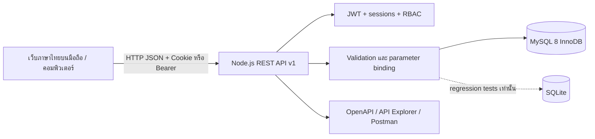
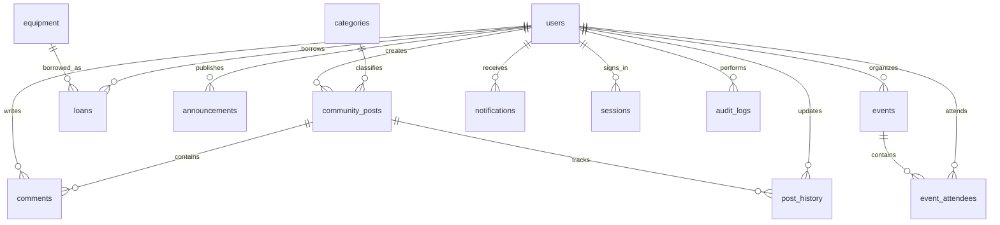

# รายละเอียดโครงงาน: ระบบศูนย์ชุมชนหมู่บ้านจัดสรร

## แนวคิดและปัญหา

เมื่อแจ้งปัญหาในกลุ่มแชต ข้อมูลอาจเลื่อนหาย ไม่ทราบว่าใครรับเรื่องหรือดำเนินการถึงขั้นใด ประกาศของหายกระจัดกระจาย และอุปกรณ์ส่วนกลางไม่มีจำนวนคงเหลือที่ตรวจสอบได้ ระบบนี้รวมงานเหล่านี้ไว้ในพื้นที่เดียว แสดงประวัติเพื่อให้ลูกบ้านติดตามและนิติบุคคลรับผิดชอบงานได้ชัดเจน

กลุ่มเป้าหมาย: ลูกบ้านในหมู่บ้านเดียวกัน เจ้าหน้าที่นิติบุคคล และ Admin ที่ดูแลสิทธิ์ระบบ ไม่ใช่เครือข่ายสังคมสาธารณะหลายหมู่บ้าน

## วัตถุประสงค์

1. ให้ลูกบ้านแจ้งปัญหาและเห็นความคืบหน้าในเรื่องของตน
2. ช่วยเพื่อนบ้านตามหาสัตว์เลี้ยง/สิ่งของ และให้ข้อมูลเพิ่มเติมผ่านความคิดเห็น
3. ลดความสับสนในการยืมอุปกรณ์ด้วยจำนวนพร้อมยืมและวันกำหนดคืน
4. ให้เจ้าหน้าที่สื่อสารผ่านประกาศ กิจกรรม และการแจ้งเตือนในระบบ
5. ใช้สถิติจากรายการจริงประกอบการวางแผนบำรุงรักษา ไม่แสดงตัวเลขประสิทธิผลที่ไม่ได้วัด

## ความสอดคล้องกับ PDF

| ข้อกำหนดใน PDF | สิ่งที่พัฒนา |
|---|---|
| users, categories, community_posts | คงชื่อตารางและชื่อ PK/FK ตาม PDF พร้อมเพิ่มข้อมูลที่จำเป็น |
| MySQL 8 / InnoDB / ACID / Foreign Keys | มี MySQL adapter, migrations, schema SQL และ transaction สำหรับสต็อก/กิจกรรม |
| role: ลูกบ้าน / นิติบุคคล / Admin | resident / juristic / admin และตรวจทุกคำขอฝั่ง API |
| JWT register/login | HS256, token อายุ 8 ชั่วโมง, session สำหรับเพิกถอน |
| GET/POST posts และ filter | มีค้นหา กรอง type/category/status/mine และ pagination |
| PATCH /posts/:id/status | มีหมายเหตุ ประวัติ ผู้ดำเนินการ และแจ้งเตือนเจ้าของ |
| DELETE /posts/:id โดย owner/admin | ตรวจสิทธิ์เจ้าของจริง และลบลูกข้อมูลตาม FK |
| ยืมคืนอุปกรณ์ | เพิ่ม equipment และ loans ตรวจจำนวน คืนโดยเจ้าหน้าที่ |
| เพิ่ม API 20+ | 55 endpoints ไม่นับ endpoint OpenAPI |

เอกสาร PDF และภาพเกณฑ์ใช้เป็นข้อมูลกำหนดงานตามคำขอผู้ใช้ ไม่มีการนำคำสั่งภายนอกอื่นจากไฟล์มารัน

## สถาปัตยกรรม

Frontend ใช้ ES modules และแยกจาก API ชัดเจน ข้อมูลไม่ได้เก็บใน localStorage ทุกการสร้าง/แก้ไขติดต่อ backend และบันทึกใน relational database

## ER diagram

13 ตาราง: users, categories, community_posts, comments, post_history, equipment, loans, announcements, events, event_attendees, notifications, sessions, audit_logs

ใช้ JSON ใน community_posts.metadata สำหรับข้อมูลขยายที่ไม่ต้องเพิ่ม column แต่ไม่ใส่ข้อมูลส่วนตัวที่ไม่จำเป็น; MySQL ใช้ ENUM บทบาท ประเภทหมวดหมู่ และสถานะ พร้อม DATETIME(3) สำหรับเวลาจริง ส่วน SQLite ใช้รูปแบบข้อมูลเทียบเท่าสำหรับการสาธิต

## สิทธิ์

| การกระทำ | ลูกบ้าน | นิติบุคคล | Admin |
|---|---|---|---|
| อ่านข่าว/เรื่อง/กิจกรรมในชุมชน | ได้ | ได้ | ได้ |
| สร้างเรื่องและความคิดเห็น | ได้ | ได้ | ได้ |
| แก้ไข/ลบเรื่องหรือความคิดเห็น | ของตัวเอง | ของตัวเอง | ทุกรายการ |
| เปลี่ยนสถานะเรื่อง | ไม่ได้ | ได้ | ได้ |
| ยืมอุปกรณ์/เข้าร่วมกิจกรรม | ได้ | ได้ | ได้ |
| ดูรายการยืม | ของตัวเอง | ทั้งหมด | ทั้งหมด |
| รับคืน/จัดอุปกรณ์/ประกาศ/กิจกรรม | ไม่ได้ | ได้ | ได้ |
| ดูรายงาน/CSV/รายชื่อผู้เข้าร่วม | ไม่ได้ | ได้ | ได้ |
| เปลี่ยนบทบาท/ระงับสมาชิก/audit logs | ไม่ได้ | ไม่ได้ | ได้ |
| อ่านการแจ้งเตือน | ของตัวเอง | ของตัวเอง | ของตัวเอง |

สมาชิกทั่วไปอ่านเรื่องในชุมชนได้ จึงไม่ควรเขียนข้อมูลส่วนตัวอ่อนไหวในโพสต์ การประกาศค้นหาสัตว์หรือของหายไม่เผยเบอร์โทรเจ้าของโดยอัตโนมัติ

## ขั้นตอนหลักที่ใช้สาธิต

**แจ้งปัญหา:** ลูกบ้านส่งเรื่อง → รอรับเรื่อง → นิติบุคคลเพิ่มหมายเหตุและเปลี่ยนเป็นกำลังดำเนินการ → เจ้าของรับแจ้งเตือน → ดำเนินการเสร็จสิ้น ประวัติยังคงตรวจสอบได้

**ยืมคืน:** เลือกอุปกรณ์ → จำนวน+กำหนดคืน+วัตถุประสงค์ → transaction ตรวจและลดจำนวน → แสดงรายการยืม → ส่งของคืนสำนักงาน → เจ้าหน้าที่ตรวจรับ → transaction เพิ่มจำนวนกลับและระบุ returned_at

**กิจกรรม:** เจ้าหน้าที่สร้างความจุ → สมาชิกเข้าร่วม → ล็อกแถวกิจกรรม ตรวจจำนวนและสมาชิกซ้ำ → ยืนยัน หรือ 409 เมื่อเต็ม → ถอนสมัครได้

## Transaction และการแข่งขันทำรายการ

MySQL ใช้ connection ต่อ transaction และ SELECT ... FOR UPDATE ล็อกอุปกรณ์/รายการยืม/กิจกรรม การตัดสต็อกมีเงื่อนไข available >= quantity อีกชั้น หากขั้นตอนใดล้มเหลว rollback ทั้งชุด

SQLite ใช้ BEGIN IMMEDIATE และคิวใน process เพื่อไม่ให้ asynchronous request แทรกระหว่าง transaction เหมาะกับโหมดสาธิต process เดียว ไม่ได้อ้างว่าขยายหลายเครื่องแบบ MySQL ได้

## การออกแบบ UI/UX

แนว Swiss: พื้นขาว/เทา เส้นแบ่งบาง สีน้ำเงินเดียวเป็น accent ใช้ตัวเลขสถิติกับโครงตารางเพื่อให้ลูกบ้านสแกนข้อมูลได้เร็ว ภาพบ้านเป็น SVG ที่วาดสำหรับโปรเจกต์ ไม่ต้องพึ่งบริการภาพภายนอก

สถานะมีทั้งสีและข้อความ มีจุดเริ่มต้นงานชัดเจน 3 งานหลัก ฟอร์มมี label และ validation; dialog กัก focus และปิดด้วย Escape; หน้ามือถือย้ายเมนูไปด้านข้างและการ์ดปรับจำนวนคอลัมน์ รองรับ prefers-reduced-motion

## ความปลอดภัยที่ทำแล้วและข้อจำกัด

ทำแล้ว: hash รหัสผ่านด้วย scrypt+salt, timing-safe comparison, JWT ลงนามและตรวจหมดอายุ, role/owner guard, HttpOnly+SameSite cookie, Secure ใน production, ตรวจ Origin ก่อนเขียน, SQL parameter binding, escape ข้อความก่อนแสดง, CSP, จำกัด JSON body 64KB, จำกัดการลอง login, CSV formula escaping และ session revocation

ยังต้องพัฒนาก่อนใช้กับข้อมูลจริง: ยืนยันการเป็นลูกบ้านก่อนเข้าชุมชน, กู้รหัสผ่านที่ตรวจสอบตัวตนได้, ตรวจนโยบายเก็บข้อมูลและความเป็นส่วนตัว, สำรอง/กู้คืนและ monitoring, ทดสอบ load บน MySQL จริง, security review และ disaster recovery ไม่อ้างว่าผ่านการตรวจภายนอกแล้ว

## จุดที่เชื่อมกับเกณฑ์อาจารย์

| เกณฑ์ | หลักฐานที่เตรียม | วิธีนำเสนอ |
|---|---|---|
| ความคิดสร้างสรรค์/ตอบโจทย์สังคมหรือธุรกิจ 10 | ประวัติเรื่อง โปร่งใสเรื่องรับผิดชอบ แบ่งปันอุปกรณ์ ดูปัญหาซ้ำจากรายงาน | สาธิตปัญหาจากแชตที่ไม่มีสถานะ แล้วให้เห็นวงจรแก้ไขจริง |
| เทคนิคพัฒนา 10 | 55 APIs, 13 tables, JWT/RBAC, FK, transaction, indexes, tests, OpenAPI | ยืมพร้อมกันแล้วหนึ่งคำขอได้ 409 + เรียก endpoint Admin ด้วยลูกบ้านได้ 403 |
| ความสวยงาม UI/UX 5 | ภาษาไทย responsive, สถานะอ่านง่าย, ฟอร์มและ accessibility | เปิด desktop/mobile และทำงานจริงหนึ่งขั้นตอน |
| การนำเสนอรายบุคคล 5 | มีสคริปต์และขอบเขตอธิบายรายคน | แต่ละคนสาธิตส่วนที่ตนเข้าใจ พร้อมตอบคำถามจากโค้ด |

คะแนนจริงขึ้นอยู่กับอาจารย์และการนำเสนอ ไม่สามารถรับประกันคะแนนเต็มได้ ผู้ส่งควรทดลองและเข้าใจโค้ดก่อนนำเสนอ

## การตั้งค่าปัจจุบัน

วิธีเปิดหลักคือ Docker Compose + MySQL 8.4; ค่าเริ่มต้น DB_CLIENT เป็น mysql และไม่มี fallback ไป SQLite หากต่อฐานไม่ได้ เว็บและฐานผ่าน health check, ทดสอบ API บน MySQL จริง 20/20 กลุ่ม และตรวจพบตาราง InnoDB 13 ตาราง ดู README สำหรับตัวเปิดและคำสั่ง stop/start โดยเก็บข้อมูลใน volume
